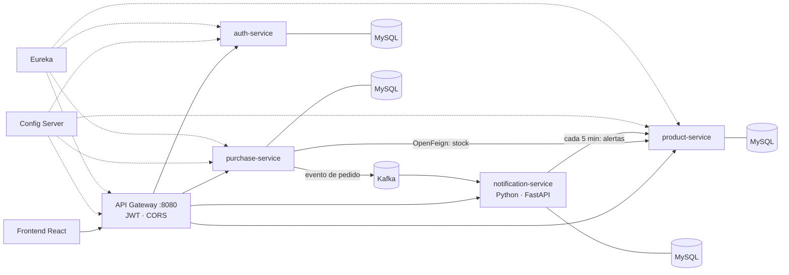
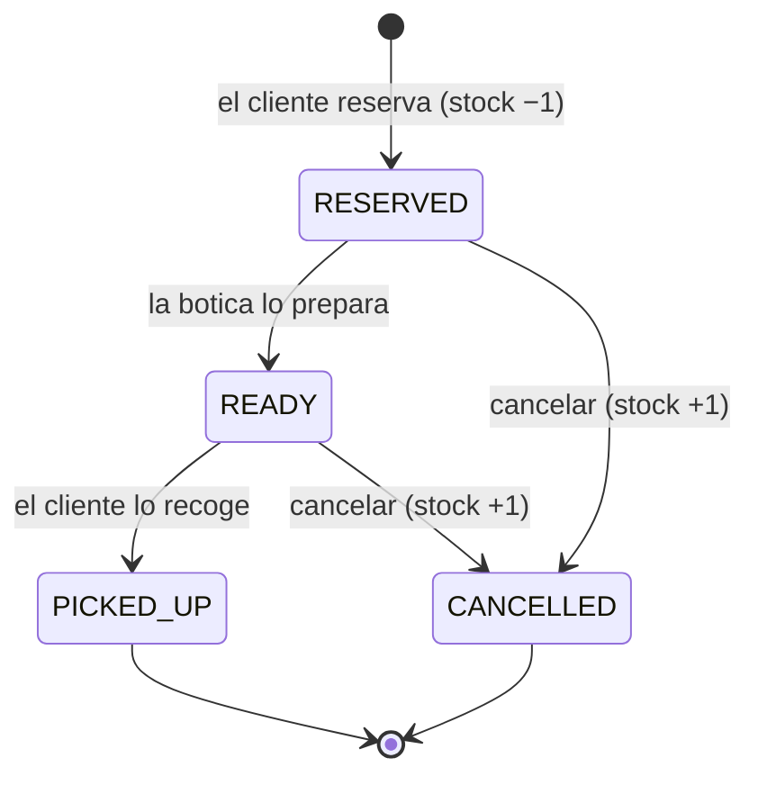

# MediTech — Reservas y control de inventario para boticas


Backend de microservicios para una **botica pequeña**: los clientes **reservan** medicamentos desde
el catálogo y **pasan a recogerlos**, y la botica controla su **inventario** con alertas automáticas de
**stock bajo** y de **productos vencidos o por vencer**.

> El cliente web (React) vive en [MediTech-Frontend](https://github.com/jro51/MediTech-Frontend).

---

## ¿Qué problema resuelve?

Muchas boticas pequeñas llevan el stock a mano: se enteran de que un producto se agotó cuando el cliente
ya lo pidió, y de que otro venció cuando lo encuentran en el estante. MediTech busca resolver eso:

| Problema | Cómo lo resuelve |
|---|---|
| Se agota un producto sin que nadie lo note | Alerta de **stock bajo** cuando `stock ≤ stock mínimo` |
| Productos vencidos en el estante | Alerta de **vencidos / por vencer** (ventana de 30 días configurable) |
| El cliente va a la botica y ya no hay stock | **Reserva** desde el catálogo: el stock se descuenta al reservar |
| La botica no sabe qué pedidos preparar | Panel con pedidos y su **estado**: reservado → listo → recogido |
| El cliente no sabe cuándo ir | Notificación cuando el pedido está **listo para recoger** |
| Medicamentos que requieren receta | Cada producto indica si **requiere receta** |

> Es un proyecto de portafolio: está pensado a partir de un problema real, pero todavía no se validó con una botica real.

---

## Arquitectura



| Servicio | Tecnología | Responsabilidad |
|---|---|---|
| **api-gateway** | Spring Cloud Gateway | Único punto de entrada: valida el JWT, inyecta la identidad y oculta los endpoints internos |
| **auth-service** | Spring Boot, Spring Security, BCrypt, JWT | Registro y login |
| **product-service** | Spring Boot, JPA | Catálogo, stock, vencimientos, receta y **alertas de inventario** |
| **purchase-service** | Spring Boot, OpenFeign, Kafka | **Reservas** y ciclo de vida del pedido; publica eventos |
| **notification-service** | Python, FastAPI, Kafka, SQLAlchemy | Avisos a clientes y bandeja de alertas de la botica |
| **config-server / eureka-server** | Spring Cloud | Configuración centralizada y descubrimiento de servicios |

### Ciclo de vida de un pedido



Cada cambio de estado publica un evento en Kafka; `notification-service` lo convierte en un aviso para el cliente
y, cuando entra una reserva nueva, en un aviso para la botica.

---

## Cómo ejecutarlo (un solo comando)

Requisitos: **Docker** con Docker Compose. No necesitas Java, Maven ni Python instalados.

```bash
git clone https://github.com/jro51/MediTech-backend.git
cd MediTech-backend
docker compose up --build
```

La primera vez tarda varios minutos (compila los 6 servicios Java dentro de Docker). Para incluir también el frontend:

```bash
docker compose --profile frontend up --build     # web en http://localhost:5173
```

> Si vienes de una versión anterior, recrea los volúmenes porque cambió el esquema de las tablas:
> `docker compose down -v`

### Primer uso

1. Regístrate: `POST http://localhost:8080/api/auth/register`
2. Para tener un usuario **ADMIN** (botica), cambia el rol directamente en la base de datos:
   ```bash
   docker compose exec auth-db mysql -uroot -proot auth_db \
     -e "UPDATE users SET role='ADMIN' WHERE email='tu@correo.com';"
   ```
3. Vuelve a hacer login para obtener un token con el rol actualizado.

---

## Documentación de la API (Swagger)

Cada servicio expone su propia documentación interactiva (publicada solo en `localhost`):

| Servicio | Swagger |
|---|---|
| auth-service | http://localhost:8081/swagger-ui.html |
| product-service | http://localhost:8082/swagger-ui.html |
| purchase-service | http://localhost:8083/swagger-ui.html |
| notification-service | http://localhost:8084/docs |

Al abrir un Swagger directamente (sin pasar por el gateway), los headers `X-User-Role` y `X-User-Id` aparecen
como parámetros: escribe `ADMIN` o un id de usuario para probar los endpoints protegidos.

### Endpoints principales (a través del gateway, `http://localhost:8080`)

| Método | Ruta | Acceso | Descripción |
|---|---|---|---|
| POST | `/api/auth/register`, `/api/auth/login` | Público | Registro e inicio de sesión |
| GET | `/api/products` · `/api/products/{id}` | Público | Catálogo |
| POST · PUT · DELETE | `/api/products[/{id}]` | ADMIN | Gestión de productos |
| GET | `/api/products/alerts?days=30` | ADMIN | Stock bajo y productos vencidos o por vencer |
| POST | `/api/purchases/buy` | Usuario | Reservar productos |
| GET | `/api/purchases/user/{userId}` | Dueño | Historial del usuario |
| GET | `/api/purchases?status=READY` | ADMIN | Todos los pedidos (filtro opcional por estado) |
| PUT | `/api/purchases/{id}/status?value=READY` | ADMIN | Avanzar o cancelar un pedido |
| GET | `/api/notifications/{userId}` | Dueño | Avisos del cliente |
| GET | `/api/notifications/admin/inbox` | ADMIN | Bandeja de la botica: reservas nuevas y alertas |

Ejemplo de producto con los campos de botica:

```json
POST /api/products   (ADMIN)
{
  "name": "Amoxicilina 500mg",
  "price": 18.50,
  "stock": 40,
  "minStock": 10,
  "expirationDate": "2027-03-31",
  "requiresPrescription": true
}
```

---

## Pruebas y cobertura

Las pruebas son rápidas: no necesitan base de datos ni Kafka (usan Mockito y MockMvc en modo *standalone*).

```bash
# Java (desde la carpeta de cada servicio)
cd product-service && ./mvnw verify          # reporte: target/site/jacoco/index.html

# Python
cd notification-service
pip install -r requirements-dev.txt
pytest --cov=. --cov-report=term-missing
```

| Servicio | Qué se prueba |
|---|---|
| product-service | Reglas de stock, alertas, validaciones, permisos por rol, manejo de errores |
| purchase-service | Creación de reservas, transiciones de estado, restauración de stock al cancelar, publicación a Kafka **solo después del commit** |
| auth-service | Registro, login, emisión y validación del JWT |
| api-gateway | Rutas públicas/protegidas, token falso o vencido, **suplantación de headers**, endpoints internos ocultos |
| notification-service | Reglas de mensajes, consumo de eventos con deduplicación, alertas diarias, API |

`product-service` y `purchase-service` exigen **al menos 70% de cobertura de líneas** (JaCoCo) en `mvn verify`.
El notification-service exige 85% en CI.

---

## CI/CD (GitHub Actions)

`.github/workflows/ci.yml`:

1. **java-tests**: un job por servicio (en paralelo) con `mvn verify`, resumen de cobertura y reporte JaCoCo como artefacto.
2. **python-tests**: `pytest` con cobertura mínima.
3. **docker-build**: valida `docker-compose` y construye todas las imágenes (los Dockerfiles compilan dentro de Docker).
4. **publish-images**: en cada push a `master`, publica las imágenes en **GitHub Container Registry** (`ghcr.io`).

---

## Decisiones técnicas

- **Reserva y recojo en lugar de e-commerce con envío:** coincide con cómo operan las boticas pequeñas y justifica el flujo de estados.
- **Mensajes por reglas, sin IA:** en un dominio de salud no se quiere texto generado sin revisión profesional. Las notificaciones son deterministas, verificables y no requieren claves de API para ejecutar el proyecto.
- **Kafka solo después del commit:** el evento se publica en `afterCommit`, para no avisar de pedidos que la base de datos terminó descartando.
- **Deduplicación en el consumidor:** Kafka puede reentregar un mensaje; cada notificación tiene una `dedupe_key` única.
- **Alertas por consulta periódica:** `notification-service` pregunta a `product-service` cada 5 minutos. Genera como máximo un aviso por producto y por día. Es más simple que publicar eventos de inventario; ver mejoras futuras.
- **Seguridad en el gateway:** valida el JWT, **descarta los headers de identidad enviados por el cliente** y bloquea desde el exterior los endpoints internos (`reduce-stock`, `restore-stock`, `check-stock`).
- **Database per Service:** cada servicio con su propia base de datos.
- **Dockerfiles multi-etapa, sin root, con puertos internos publicados solo en `127.0.0.1`.**

## Limitaciones conocidas

- Cada producto tiene **una sola fecha de vencimiento**; un modelo real manejaría **lotes** (varias fechas por producto, salida por FEFO).
- Los servicios internos confían en los headers `X-User-*` que inyecta el gateway: por eso solo el gateway debe ser accesible desde fuera.
- Las contraseñas de MySQL (`root/root`) y el `JWT_SECRET` por defecto son **solo para desarrollo**; define `JWT_SECRET` en el entorno.
- Las tablas se crean con `ddl-auto: update` (sin migraciones Flyway/Liquibase).
- No hay despliegue en la nube (son ~14 contenedores); la demo se levanta con Docker Compose.

## Mejoras futuras

- [ ] Lotes de productos y salida por FEFO
- [ ] Circuit Breaker (Resilience4j) entre `purchase-service` y `product-service`
- [ ] Eventos de inventario en Kafka en lugar de consulta periódica
- [ ] Notificaciones por correo o WhatsApp (modo sandbox)
- [ ] Migraciones con Flyway y pruebas de integración con Testcontainers
- [ ] Trazabilidad distribuida con Zipkin

---

## Estructura

```
MediTech-backend/
├── docker-compose.yaml
├── .github/workflows/ci.yml
├── api-gateway/          auth-service/        product-service/
├── purchase-service/     config-server/       eureka-server/
└── notification-service/   (Python)
```
